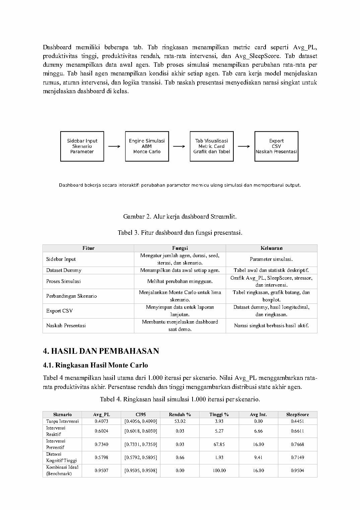

# Simulasi tidur dan produktivitas mahasiswa

Proyek Pemodelan dan Simulasi membangun model agen untuk mengeksplorasi perubahan indeks produktivitas dalam lima skenario. Data agen bersifat dummy dan bobot transisi ditetapkan sebagai asumsi model. Hasilnya menggambarkan perilaku simulasi, dengan generalisasi empiris yang belum diuji.

## Desain model

Satu iterasi memodelkan 30 agen selama 16 minggu. Variabel agen meliputi productivity level, sleep hours, sleep quality, sleep regularity, academic stress, cognitive distortion, dan hygiene intervention. SleepScore, manfaat tidur, serta dampak stres menentukan perubahan PL pada rentang 0–1.

Lima skenario adalah tanpa intervensi, intervensi reaktif, intervensi preventif, distorsi kognitif tinggi, dan kombinasi ideal. Intervensi reaktif aktif ketika PL di bawah 0,55. Benchmark ideal mengubah beberapa parameter sekaligus. Notebook memakai `BASE_SEED=2026` dan 1.000 iterasi Monte Carlo per skenario.

## Hasil historis notebook

| Skenario | Rata-rata PL akhir | CI 95% dari simulasi |
| --- | ---: | --- |
| Tanpa intervensi | 0,4073 | [0,4056; 0,4090] |
| Reaktif | 0,6024 | [0,6018; 0,6030] |
| Preventif | 0,7340 | [0,7331; 0,7350] |
| Distorsi kognitif tinggi | 0,5798 | [0,5792; 0,5805] |
| Kombinasi ideal | 0,9507 | [0,9505; 0,9508] |

Sumber: [notebook Mesa asli](notebooks/mesa-original.ipynb), output sel 26, dan [laporan](evidence/laporan.pdf), Tabel 4 halaman 4. Interval mencerminkan variasi pengulangan dalam model; ketidakpastian asumsi dan kesesuaian dengan mahasiswa nyata belum tercakup.



Grafik hasil tersedia pada [halaman 5 laporan](evidence/laporan-page-5.png). Perbedaan PL antara skenario bergantung pada aturan transisi dan parameter yang ditetapkan.

## Notebook dan dashboard

Notebook memakai Mesa, termasuk kelas `Mahasiswa`, `ModelTidurProduktivitas`, dan aktivasi agen melalui `self.agents.shuffle_do("step")`. Output sumber mencatat Mesa 3.3.1.

Dashboard yang ditemukan memakai loop Python dan `random.Random`, dengan dependensi Streamlit, pandas, NumPy, dan matplotlib. Kode dashboard ini belum menggunakan Mesa. Keduanya menyediakan fungsi simulasi, tetapi angka notebook tidak otomatis mewakili hasil dashboard karena urutan aktivasi dan konsumsi angka acak dapat berbeda.

Dashboard memiliki mode satu skenario, perbandingan semua skenario, dan eksperimen kustom. Pengguna dapat mengatur parameter, memeriksa data awal, melihat hasil mingguan, dan mengekspor CSV.

## Menjalankan

Untuk dashboard, buka terminal pada folder `dashboard/`, lalu jalankan:

```powershell
python -m pip install -r requirements.txt
python -m streamlit run app.py
```

Untuk notebook Mesa, buka `notebooks/mesa-original.ipynb` di Jupyter/Colab. Pasang dependensi dari `requirements-notebook.txt`; sel instalasi notebook juga dapat memasang Mesa. Jalankan berurutan dan periksa nilai seed, jumlah agen, minggu, dan iterasi. Simpan CSV hasil baru dengan identitas implementasi yang digunakan.

## Batasan dan pengembangan

Pemeriksaan saat ini membaca kode dan output notebook; simulasi penuh serta antarmuka dashboard belum dijalankan ulang. Bobot belum dikalibrasi dengan data lapangan dan PL belum menjadi instrumen produktivitas yang tervalidasi. Model bersifat eksploratif.

Pengembangan berikutnya adalah memakai satu modul simulasi untuk notebook dan dashboard, memeriksa kesamaan hasil pada seed yang sama, lalu menganalisis sensitivitas bobot. Pisahkan ketidakpastian Monte Carlo dari ketidakpastian pilihan model.

Laporan mencantumkan Naufal Zainul Zaki. Kontribusi pribadi perlu dikonfirmasi sebelum memakai klaim tindakan individu pada CV atau profil publik.
